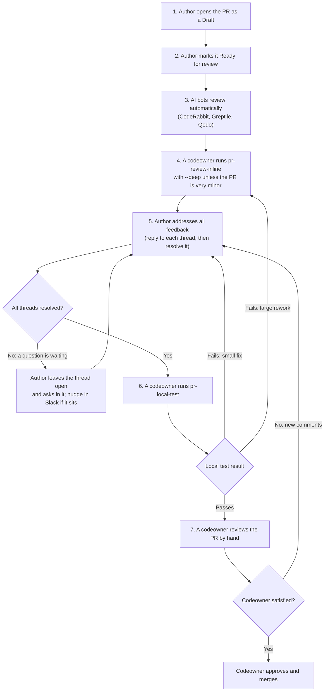

# Pull request review process

Every pull request goes through the same stages on its way to `main`: automated AI review, a deeper AI review run by a codeowner, the author's fixes, a hands-on local test, and a codeowner's approval. Most of the reviewing is done by AI, so the codeowners — all volunteers — spend their time on a PR that has already been checked, fixed, and tested.

Codeowners (listed in [`.github/CODEOWNERS`](../.github/CODEOWNERS)) run the review and test skills. If you're an author who isn't a codeowner, your part is opening the PR, marking it ready, and addressing the feedback.

## The flow



Every push re-runs the AI bots, so their comments on the new code arrive on their own whenever the flow loops back.

## Who does what

| Stage                     | Who                        | What they do                                                                             |
| ------------------------- | -------------------------- | ---------------------------------------------------------------------------------------- |
| 1. Open as Draft          | Author                     | Opens the PR in **Draft** while the work is in progress                                  |
| 2. Ready for review       | Author                     | Switches the PR to **Ready for review** once it's done and CI passes                     |
| 3. Bot review             | CodeRabbit, Greptile, Qodo | Post review comments automatically; nothing to start                                     |
| 4. Inline review          | A codeowner                | Runs the `pr-review-inline` skill once the bots have finished                            |
| 5. Address feedback       | Author                     | Fixes, replies to, and resolves every thread; the `address-pr-comments` skill helps      |
| 6. Local test             | A codeowner                | Runs the `pr-local-test` skill once every thread is resolved                             |
| 7. Final review and merge | A codeowner                | Reviews by hand, then approves and merges, or leaves comments that send the PR back to 5 |

### How to tell it's your turn

Run `pnpm pr:triage` (or `pnpm pr:triage:html` for a board in your browser). It sorts every open PR by the stage it's waiting on — bots, `pr-review-inline`, the author, `pr-local-test`, or a codeowner — so you can pick up whatever needs you. See [For codeowners: finding PRs to review](CONTRIBUTING.md#for-codeowners-finding-prs-to-review) for setup.

## Running the review and test skills

Running either skill takes one command and a PR number. Both live in [`.agents/skills/`](../.agents/skills/). Codex reads that folder directly; Claude Code gets a copy that the repo's session-start hook refreshes, so both see the same skills with nothing to install.

### Set up your machine (once)

**Required.** Each skill checks its tools at the start and lists anything missing in one message.

| What                                                                                             | Needed by       | Why                                                                                                           |
| ------------------------------------------------------------------------------------------------ | --------------- | ------------------------------------------------------------------------------------------------------------- |
| A **frontier model** in your assistant (the most capable Claude or Codex model available to you) | Both            | These runs are the main line of review for the PR, and smaller models miss the subtle bugs it exists to catch |
| `git`, `jq`, and the [GitHub CLI](https://cli.github.com), signed in with `gh auth login`        | Both            | Fetching the PR and posting the review                                                                        |
| Docker, running                                                                                  | `pr-local-test` | Each run starts its own database and services                                                                 |
| `curl`, `openssl`, and `lsof` (macOS) or `ss` (Linux and WSL)                                    | `pr-local-test` | Health checks, test secrets, and finding free ports                                                           |
| [nvm](https://github.com/nvm-sh/nvm) or another Node version manager                             | `pr-local-test` | The run uses the Node version the PR asks for; if it's missing, the skill gives you the install command       |

On Windows, run everything inside WSL 2, as for the rest of this repo.

**Recommended add-ons.** Each skill works without these and falls back on its own.

| Add-on                                                               | Helps                     | What you get                                                                                                                                                                                                | Claude Code install                                         |
| -------------------------------------------------------------------- | ------------------------- | ----------------------------------------------------------------------------------------------------------------------------------------------------------------------------------------------------------- | ----------------------------------------------------------- |
| `pr-review-toolkit` plugin                                           | `pr-review-inline --deep` | `--deep` hands the review to its specialist reviewers (silent failures, test coverage, type design, comments). Without it, `--deep` runs more general-purpose reviewers instead. Claude Code only.          | `/plugin install pr-review-toolkit@claude-plugins-official` |
| [Superpowers](https://github.com/obra/superpowers)                   | `pr-review-inline`        | Its `requesting-code-review` skill writes the brief each reviewer works from. The skill ships its own copy of that brief and results are the same either way, so this one is the least important.           | `/plugin install superpowers@claude-plugins-official`       |
| [Playwright MCP server](https://github.com/microsoft/playwright-mcp) | `pr-local-test`           | Lets the agent click through the running apps itself and take screenshots. Without it, the agent falls back to writing a Playwright script for each browser check, and hands you any check it can't script. | `/plugin install playwright@claude-plugins-official`        |

For Codex, add the Playwright MCP server with `codex mcp add playwright -- npx @playwright/mcp@latest`, and follow the Codex steps in the Superpowers README.

Don't point `pr-local-test` at your own browser (such as Claude in Chrome): it holds your real sign-ins, so the skill always uses a separate browser.

### Run it

1. **Start a new session** with your AI assistant, opened in your copy of this repository: a new `claude` in a terminal or a new session in the Claude desktop app, or a new Codex thread. A fresh session keeps the review from inheriting whatever you were working on.
2. **Type the skill with the PR number.** For PR 1234:

   ```text
   /pr-review-inline 1234 --deep
   ```

   ```text
   /pr-local-test 1234
   ```

   In Codex, start the command with `$` instead of `/`, or ask in plain words: "Run the pr-review-inline skill on PR 1234 with --deep."

3. **Let it work.** `pr-review-inline` posts its findings as line-level comments on the PR. `pr-local-test` shows you its results and a draft review, and posts only after you tell it to.

`--deep` runs several specialized reviewers instead of one; use it for anything beyond a very minor PR. `pr-local-test` holds back a passing verdict while any review thread is still open, so run it after stage 5 is finished. Each skill file lists its other options: [`pr-review-inline`](../.agents/skills/pr-review-inline/SKILL.md), [`pr-local-test`](../.agents/skills/pr-local-test/SKILL.md).

### Your own work is never touched

It doesn't matter what branch you're on or what uncommitted changes you have. Each skill does its work in a **worktree**: a second, separate folder holding its own copy of the repository's files, linked to the same git history. The skill checks the PR out there, so your folder, branch, and changes stay exactly as they were. When the run ends, the skill deletes the worktree.

`pr-local-test` goes further: its run gets its own Docker containers, database, and ports, so your own local apps and database keep running alongside it.

### Run several at once

Because every run has its own worktree, you can review or test several PRs at the same time, each in its own session, while you keep using your assistant for other work in other sessions. Start one new session per PR. `pr-local-test` runs the apps for each PR it tests, so how many of those your machine handles at once depends on its memory and CPU.

### Who runs which

When the PR's author is a codeowner, have a different codeowner run at least one of the two skills when you can. An author running both with their own assistant can carry the same blind spots through both. The final codeowner review still catches this, but a second person's run is cheaper.

## Addressing feedback

For every review thread — from a bot, the inline review, the local test, or a codeowner:

1. **Reply first.** Say what you changed, or why you're not changing it. The reply is the only record a reviewer has of how the comment was handled.
2. **Then resolve it yourself.** Click **Resolve conversation** on GitHub once you believe the item is handled. Only people resolve threads: AI assistants post replies but never resolve threads, so each resolution means a person has read the reply and agrees it's done.
3. **Out-of-scope suggestions** become a new Issue. Put the Issue number in your reply, then resolve the thread.
4. **Still have a question?** Leave the thread open and make the question clear in a reply. Reviewers are volunteers with a lot of PRs, so an answer can take a while; it's perfectly fine to point someone at the waiting question in the F3 developers Slack.

The [`address-pr-comments`](../.agents/skills/address-pr-comments/SKILL.md) skill walks your AI assistant through the open threads, makes the fixes, and drafts the replies. You still resolve the threads yourself.

If a fix turns into a large rework, a codeowner runs `pr-review-inline` again before the PR moves on, since the earlier review no longer covers the code that's there now.

## The `ready for human review` label

A scheduled workflow, [`ready-for-human-review-label.yml`](../.github/workflows/ready-for-human-review-label.yml), adds this label once the AI bots' threads are resolved, checks pass, and the PR has no merge conflicts, and removes it when any of those stop being true. Authors with `write` access can also add it by hand. It marks the end of the bot-feedback part of stage 5, not readiness for a codeowner's final review — use `pnpm pr:triage` to see which stage a PR is really in. [CONTRIBUTING.md](CONTRIBUTING.md#submitting-changes) has the label's full rules.

## Small PRs

Small, self-evident PRs — a one-line fix, a doc correction — don't need the full flow. A codeowner may approve and merge one directly, and `pr-review-inline` without `--deep` is enough for one that gets a review at all.
