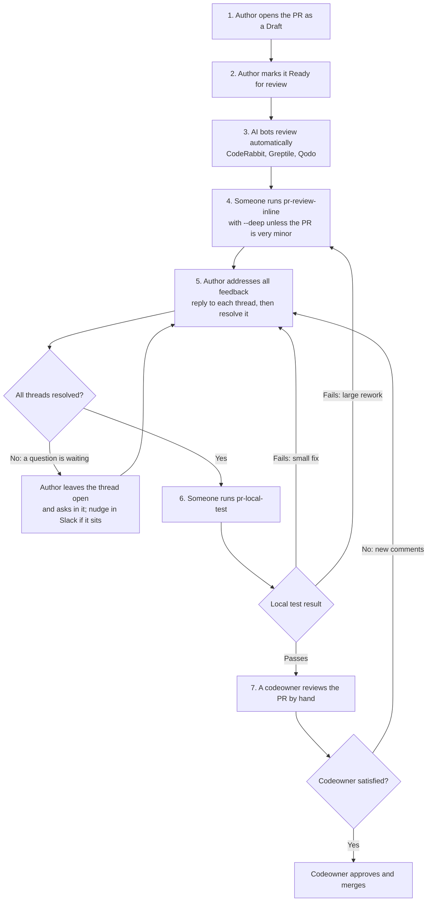

# Pull request review process

Every pull request goes through the same stages on its way to `main`: automated AI review, a deeper AI review run by a person, the author's fixes, a hands-on local test, and a codeowner's approval. Most of the reviewing is done by AI, so the codeowners — all volunteers — spend their time on a PR that has already been checked, fixed, and tested.

You don't need to be a codeowner to move a PR forward. Anyone, including the PR's author, can run the review and test skills.

## The flow

Every push re-runs the AI bots, so their comments on the new code arrive on their own whenever the flow loops back.

## Who does what

| Stage                     | Who                                     | What they do                                                                             |
| ------------------------- | --------------------------------------- | ---------------------------------------------------------------------------------------- |
| 1. Open as Draft          | Author                                  | Opens the PR in **Draft** while the work is in progress                                  |
| 2. Ready for review       | Author                                  | Switches the PR to **Ready for review** once it's done and CI passes                     |
| 3. Bot review             | CodeRabbit, Greptile, Qodo              | Post review comments automatically; nothing to start                                     |
| 4. Inline review          | Anyone, the author included             | Runs the `pr-review-inline` skill once the bots have finished                            |
| 5. Address feedback       | Author                                  | Fixes, replies to, and resolves every thread; the `address-pr-comments` skill helps      |
| 6. Local test             | Anyone, the author included             | Runs the `pr-local-test` skill once every thread is resolved                             |
| 7. Final review and merge | A codeowner (from `.github/CODEOWNERS`) | Reviews by hand, then approves and merges, or leaves comments that send the PR back to 5 |

### How to tell it's your turn

Run `pnpm pr:triage` (or `pnpm pr:triage:html` for a board in your browser). It sorts every open PR by the stage it's waiting on — bots, `pr-review-inline`, the author, `pr-local-test`, or a codeowner — so you can pick up whatever needs you. See [For codeowners: finding PRs to review](CONTRIBUTING.md#for-codeowners-finding-prs-to-review) for setup.

## Running the review and test skills

Both skills live in [`.agents/skills/`](../.agents/skills/) and work with any AI coding assistant that reads that folder, such as Claude Code or Codex.

- **Use a frontier model** (the most capable Claude or Codex model available to you). These runs are the main line of review for the PR, and smaller models miss the subtle bugs this stage exists to catch.
- **`pr-review-inline`** posts its findings as line-level comments on the PR. Pass `--deep` for anything beyond a very minor PR: it runs several specialized reviewers instead of one. See [its skill file](../.agents/skills/pr-review-inline/SKILL.md) for the other options.
- **`pr-local-test`** pulls the PR into a throwaway local sandbox, exercises the change in the running apps, and posts the result as a review. It holds back a passing verdict while any review thread is still open, so run it after stage 5 is finished. See [its skill file](../.agents/skills/pr-local-test/SKILL.md).
- **When you can, have someone other than the author run at least one of the two skills.** An author running both with their own assistant can carry the same blind spots through both. The codeowner's review still catches this, but a second person's run is cheaper.

## Addressing feedback

For every review thread — from a bot, the inline review, the local test, or a codeowner:

1. **Reply first.** Say what you changed, or why you're not changing it. The reply is the only record a reviewer has of how the comment was handled.
2. **Then resolve it yourself.** Click **Resolve conversation** on GitHub once you believe the item is handled. Only people resolve threads: AI assistants post replies but never resolve threads, so each resolution means a person has read the reply and agrees it's done.
3. **Out-of-scope suggestions** become a new Issue. Put the Issue number in your reply, then resolve the thread.
4. **Still have a question?** Leave the thread open and make the question clear in a reply. Reviewers are volunteers with a lot of PRs, so an answer can take a while; it's perfectly fine to point someone at the waiting question in the F3 developers Slack.

The [`address-pr-comments`](../.agents/skills/address-pr-comments/SKILL.md) skill walks your AI assistant through the open threads, makes the fixes, and drafts the replies. You still resolve the threads yourself.

If a fix turns into a large rework, run `pr-review-inline` again before moving on, since the earlier review no longer covers the code that's there now.

## The `ready for human review` label

A scheduled workflow, [`ready-for-human-review-label.yml`](../.github/workflows/ready-for-human-review-label.yml), adds this label once the AI bots' threads are resolved, checks pass, and the PR has no merge conflicts, and removes it when any of those stop being true. Authors with `write` access can also add it by hand. It marks the end of the bot-feedback part of stage 5, not readiness for a codeowner's final review — use `pnpm pr:triage` to see which stage a PR is really in. [CONTRIBUTING.md](CONTRIBUTING.md#submitting-changes) has the label's full rules.

## Small PRs

Small, self-evident PRs — a one-line fix, a doc correction — don't need the full flow. A codeowner may approve and merge one directly, and `pr-review-inline` without `--deep` is enough for one that gets a review at all.
