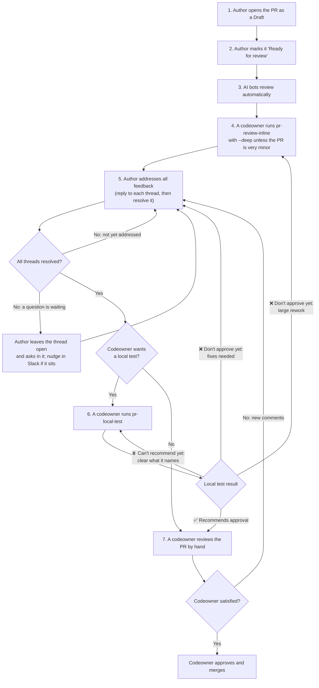

# Pull request review process

A pull request goes through these review stages on its way to `main`: automated AI review, a deeper AI review run by a codeowner, a hands-on local test, and a codeowner's approval. After each stage, the author addresses whatever feedback it raised before the PR moves on. Most of the reviewing is done by AI, so the codeowners — all volunteers — spend their time on a PR that has already been checked, fixed, and tested. Small PRs may skip some stages; see [Small PRs](#small-prs).

Codeowners (listed in [`.github/CODEOWNERS`](../.github/CODEOWNERS)) run the review and test skills. `pr-local-test` runs the PR's code on your own machine, and both skills' results carry weight in the final review, so someone accountable for the code runs them. Anyone else is welcome to run them too, as extra input. If you're an author who isn't a codeowner, your part is opening the PR, marking it ready, and addressing the feedback, including resolving the review threads.

## The flow



`--deep` makes `pr-review-inline` add more reviewers, each focused on one aspect of the code. It takes longer and uses more tokens, so a very minor PR can skip it.

On a PR's first pass, the answer to "Codeowner wants a local test?" is normally Yes. No is for a small PR (see [Small PRs](#small-prs)), or for fixes after a local test that a reviewer can confirm by reading the diff.

Most of the AI bots review each new push as well, so their comments on the new code usually arrive on their own whenever the flow loops back. The bots whose open threads keep the `ready for human review` label off are listed in `BOT_LOGINS` in [`ready-for-human-review-label.cjs`](../.github/scripts/ready-for-human-review-label.cjs).

## Who does what

| Stage                     | Who            | What they do                                                                                                       |
| ------------------------- | -------------- | ------------------------------------------------------------------------------------------------------------------ |
| 1. Open as Draft          | Author         | Opens the PR in **Draft** while the work is in progress                                                            |
| 2. Ready for review       | Author         | Switches the PR to **Ready for review** once the work is ready for others to review and CI passes\*                |
| 3. Bot review             | AI review bots | Post review comments automatically; nothing to start                                                               |
| 4. Inline review          | A codeowner    | Runs the `pr-review-inline` skill once the bots have finished                                                      |
| 5. Address feedback       | Author         | Fixes, replies to, and resolves every thread; the `address-pr-comments` skill helps                                |
| 6. Local test             | A codeowner    | Runs the `pr-local-test` skill once every thread is resolved, unless the codeowner decides the PR doesn't need one |
| 7. Final review and merge | A codeowner    | Reviews by hand, then approves and merges, or leaves comments that send the PR back to the author                  |

\* **First-time contributors:** when someone who has never had a PR merged here opens one from a fork, its CI doesn't start until a maintainer approves the run. This keeps code from an unknown account from running in the repository's CI. Mark the PR ready once the work is ready for review; CI starts after the approval. Once one of your PRs has merged, the hold no longer applies.

### How to tell it's your turn

Anyone can run `pnpm pr:triage`, author or codeowner. It sorts every open PR by the stage it's waiting on, so you can pick up whatever needs you, including your own PRs that are waiting on you. [Finding PRs that need you](CONTRIBUTING.md#finding-prs-that-need-you) covers its setup and options.

## Running the review and test skills

Running either skill takes one command and a PR number. Both live in [`.agents/skills/`](../.agents/skills/).

### Set up your machine (once)

- **Install the tools each skill needs.** Each skill checks them at the start and lists anything missing in one message. The lists live in the skills themselves: the Requirements table in [`pr-review-inline`](../.agents/skills/pr-review-inline/SKILL.md#requirements), and the `compatibility` line at the top of [`pr-local-test`](../.agents/skills/pr-local-test/SKILL.md), which also needs Docker running. On Windows, work inside WSL 2, as [AGENTS.md](../AGENTS.md#environment-setup) describes for the whole repo.
- **Add the recommended add-ons.** Each skill works without them and falls back on its own, but runs better with them:

| Add-on                                                               | Helps                     | What you get                                                                                                                                                                             | Claude Code install                                         |
| -------------------------------------------------------------------- | ------------------------- | ---------------------------------------------------------------------------------------------------------------------------------------------------------------------------------------- | ----------------------------------------------------------- |
| `pr-review-toolkit` plugin                                           | `pr-review-inline --deep` | Specialist reviewers for `--deep`. Claude Code only.                                                                                                                                     | `/plugin install pr-review-toolkit@claude-plugins-official` |
| [Playwright MCP server](https://github.com/microsoft/playwright-mcp) | `pr-local-test`           | The agent clicks through the running apps itself and takes screenshots, instead of scripting each browser check ([details](../.agents/skills/pr-local-test/reference.md#browser-checks)) | `/plugin install playwright@claude-plugins-official`        |
| [Superpowers](https://github.com/obra/superpowers)                   | `pr-review-inline`        | Least important: the skill ships its own copy of the reviewer brief this provides, and results are the same either way                                                                   | `/plugin install superpowers@claude-plugins-official`       |

For Codex, add the Playwright MCP server with `codex mcp add playwright -- npx @playwright/mcp@latest`, and follow the Codex steps in the Superpowers README.

### Run it

1. **Start a new session** with your AI assistant, opened in your copy of this repository: a new `claude` in a terminal or a new session in the Claude desktop app, or a new Codex thread. A fresh session keeps the review from inheriting whatever you were working on. **Use a frontier model** (the most capable Claude or Codex model available to you): these runs are the main line of review for the PR, and smaller models miss the subtle bugs this stage exists to catch.
2. **Type the skill with the PR number.** For PR 1234:

   ```text
   /pr-review-inline 1234 --deep
   ```

   ```text
   /pr-local-test 1234
   ```

   Leave off `--deep` only for a very minor PR; it adds focused reviewers at the cost of time and tokens. In Codex, start the command with `$` instead of `/`, or ask in plain words: "Run the pr-review-inline skill on PR 1234 with --deep."

3. **Let it work.** `pr-review-inline` posts its findings as line-level comments on the PR. `pr-local-test` shows you its results and a draft review, and posts only after you tell it to.

Run `pr-local-test` once every review thread is resolved, since it won't recommend approval while any is still open. Each skill file explains its options and verdicts: [`pr-review-inline`](../.agents/skills/pr-review-inline/SKILL.md), [`pr-local-test`](../.agents/skills/pr-local-test/SKILL.md).

### Your own work is never touched

It doesn't matter what branch you're on or what uncommitted changes you have. Each skill does its work in a **worktree**: a second, separate folder holding its own copy of the repository's files, linked to the same git history. The skill checks the PR out there, so your folder, branch, and changes stay exactly as they were. When the run ends, the skill deletes the worktree (unless you asked `pr-local-test` to keep its environment running).

`pr-local-test` goes further: its run gets its own Docker containers, database, and ports, so your own local apps and database keep running alongside it.

### Run several at once

Because every run has its own worktree, you can review or test several PRs at the same time, each in its own session, while you keep using your assistant for other work in other sessions. Start one new session per PR. `pr-local-test` runs the apps for each PR it tests, so how many of those your machine handles at once depends on its memory and CPU.

### Who runs which

When the PR's author is a codeowner, have a different codeowner run at least one of the two skills when you can. An author running both with their own assistant can carry the same blind spots through both. The final codeowner review can still catch what they miss, but by then it costs another round of fixes and often a re-test; a second person's skill run catches it earlier.

## After the local test

When a codeowner decides a PR doesn't need a local test, or when `pr-local-test` recommends approval, the PR goes to a codeowner's final review.

⏸️ **Can't recommend yet** means something kept the test from finishing — a review thread still open, a check it couldn't run, a merge status it couldn't confirm — not a problem in the code. Clear what it names, then run the local test again.

❌ **Don't approve yet** means the PR caused a problem: its results say what has to change, and the author makes those fixes. Whether `pr-local-test` runs again afterward is the reviewer's call: a re-run is worth it when the fixes change how the app behaves, and not when a reviewer can confirm them by reading the diff. A large rework goes back through `pr-review-inline` first, since the earlier review no longer covers the code that's there now. `pnpm pr:triage` doesn't send a PR back to a skill that has already run, except a local test that couldn't recommend yet, which goes back to the local-test queue. So the codeowner who asked for the fixes watches for the author's push.

## Addressing feedback

**The PR's author is responsible for resolving its review threads.** For every thread — from a bot, the inline review, the local test, or a codeowner:

1. **Reply first.** Say what you changed, or why you're not changing it. When you changed code, link the commit that has the fix. The reply is the only record a reviewer has of how the comment was handled.
2. **Then resolve it.** Click **Resolve conversation** on GitHub once you believe the item is handled. AI assistants post replies but never resolve threads, so each resolution means the author has read the reply and agrees it's done. Some review bots, CodeRabbit among them, resolve their own thread once a reply or push satisfies them; a thread that's already resolved needs nothing more.
3. **Out-of-scope suggestions** become a new Issue. Put the Issue number in your reply, then resolve the thread.
4. **Still have a question?** Leave the thread open and make the question clear in a reply. @-mention the person who raised the comment, including when their AI assistant posted it for them, so GitHub notifies them; a review bot doesn't need it. Reviewers are volunteers with a lot of PRs, so an answer can take a while; it's perfectly fine to point someone at the waiting question in the F3 developers Slack.

The [`address-pr-comments`](../.agents/skills/address-pr-comments/SKILL.md) skill walks your AI assistant through the open threads and plans the fixes and replies; once you approve the plan, it pushes the fixes and posts the replies. You still resolve the threads yourself.

## The `ready for human review` label

The label marks the end of the bot feedback, not readiness for a codeowner's final review; `pnpm pr:triage` shows which stage a PR is really in. [CONTRIBUTING.md](CONTRIBUTING.md#submitting-changes) covers when it's added and removed.

## Small PRs

A small, self-evident PR — a one-line fix, a doc correction — may not need every stage. The codeowners decide which stages it skips: one might get `pr-review-inline` without `--deep` and no local test, and another might be approved and merged directly.
