# Region Pages Cutover and Neon Retirement

Move `regions.f3nation.com` from the legacy app (repo `f3-nation/f3-region-pages`, GCP project `region-pages`) to the monorepo app (`apps/region-pages`, GCP project `f3-region-pages-app`, live today at `regions2.f3nation.com`), then retire the legacy Neon database (about 26 USD/mo) after a 14 day soak.

Nothing in this runbook deletes services or data until the final, signoff-gated teardown section.

## Asks

- Tackle (@taterhead247): accept ownership of the cutover, pick the window, and decide rollback.
- Fortran (@dfoster42): review `apps/region-pages/src/proxy.ts` and `src/lib/redirect.ts`.
- @BigGillyStyle: run the daily soak check below and escalate to Tackle in #region-pages on any trigger.

The domain mapping lives in `f3-region-pages-app`, so the release lead runs the cutover.



## Why this is safe

- The new app reads F3 data from Cloud SQL `f3data` through `apps/api`; it has no Neon dependency.
- Region slugs match exactly: on 2026-11-11 the 573 legacy home page slugs and the 573 regions2 sitemap slugs matched exactly. Both use lodash `kebabCase(name)`; `region-events.json` is byte-identical between the two repos.
- The legacy service and its Neon database stay running through the soak. Cutover changes two legacy things, both reversible: ingest is paused and `cron-secret-tf` gets a new version. Rollback moves the mapping back and restores both.
- The regions2 redirect is a 307 (temporary) during the soak, so browsers do not cache it. It becomes a 301 only at teardown signoff.
- Expected visitor impact: the regions.f3nation.com certificate gap after the mapping moves, of unknown length. The 60 minute cap below is the rollback threshold.

## Pre-checks

- [ ] The region-pages staging soak and production go/no-go in the release plan issue are checked.
- [ ] `curl -fsS https://regions2.f3nation.com/health` succeeds.
- [ ] API per-IP rate limit headroom is acceptable for a cold crawl after the canonical change.
- [ ] Production `SITE_URL` is recorded and is not regions.f3nation.com, and `REGIONS2_REDIRECT_STATUS` is unset or 307.
- [ ] A release containing the regions2 redirect (`apps/region-pages/src/proxy.ts`) is deployed to prod. It is inert until `SITE_URL` changes.
- [ ] After that deploy, `curl -sI https://regions2.f3nation.com/` still returns 200 (stop on any redirect).
- [ ] The account running the cutover is a verified owner of the domain: `gcloud domains list-user-verified` lists `f3nation.com` (or `regions.f3nation.com`).
- [ ] Neon backup is less than 7 days old (else take a fresh `pg_dump -Fc`).
- [ ] Record the current state:
  - `gcloud beta run domain-mappings list --project region-pages --region us-central1`
  - `gcloud run services describe f3-region-pages --project f3-region-pages-app --region us-central1`

## Cutover (low traffic window)

1. Pause the legacy ingest. Find the caller of `POST /api/ingest` on the legacy service (Cloud Scheduler is disabled in `region-pages`, so check other projects, GitHub Actions, and local launchd jobs) and disable it. Then rotate the Secret Manager secret the service reads (`CRON_SECRET` from `cron-secret-tf:latest`) so any unknown caller gets 401. Record the version the service runs now; the value never appears on a command line:

   ```sh
   # The service binds cron-secret-tf:latest; confirm, then record the version.
   set -euo pipefail
   gcloud run services describe f3-region-pages --project region-pages \
     --region us-central1 --format='value(spec.template.spec.containers[0].env)'
   OLD=$(gcloud secrets versions list cron-secret-tf --project region-pages \
     --filter='state=ENABLED' --sort-by='~createTime' --limit 1 \
     --format='value(name)')
   echo "record this: OLD=$OLD"
   [ -n "$OLD" ] || { echo "no enabled cron-secret-tf version found; stop" >&2; exit 1; }
   openssl rand -hex 32 | gcloud secrets versions add cron-secret-tf \
     --project region-pages --data-file=-
   gcloud run services update f3-region-pages --project region-pages \
     --region us-central1 --update-secrets CRON_SECRET=cron-secret-tf:latest
   ```

2. Release the domain from the legacy project (the service keeps running):

   ```sh
   gcloud beta run domain-mappings delete --domain regions.f3nation.com \
     --project region-pages --region us-central1
   ```

3. Map it to the monorepo app. DNS already points at `ghs.googlehosted.com`; expect a short gap while the managed certificate issues.

   ```sh
   gcloud beta run domain-mappings create --service f3-region-pages \
     --domain regions.f3nation.com --project f3-region-pages-app --region us-central1
   gcloud beta run domain-mappings describe --domain regions.f3nation.com \
     --project f3-region-pages-app --region us-central1
   ```

   Gate: do not continue until the mapping reports `Ready` and
   `curl -fsS https://regions.f3nation.com/health` succeeds. If it is not ready
   within 60 minutes, run the Rollback below and reschedule.

4. Point canonicals at the real domain, which also activates the regions2 307:

   ```sh
   gcloud run services update f3-region-pages --project f3-region-pages-app \
     --region us-central1 --update-env-vars SITE_URL=https://regions.f3nation.com
   ```

   The deploy workflow (`_deploy-cloudrun.yml`) sets no env vars, so the service value persists across releases. After the next release, re-check the canonical tag.

## Verification

- [ ] `curl -sS https://regions.f3nation.com/ | grep -o '<link rel="canonical"[^>]*>'` names regions.f3nation.com.
- [ ] Every `<loc>` in `https://regions.f3nation.com/sitemap.xml` is on regions.f3nation.com and the region count is 573.
- [ ] Three sample region slugs and one event page return 200.
- [ ] `curl -sI 'https://regions2.f3nation.com/<slug>?letter=a'` returns 307 to `https://regions.f3nation.com/<slug>?letter=a`.
- [ ] `f3region.info` still lands on regions.f3nation.com.
- [ ] `curl -s -o /dev/null -w '%{http_code}' -X POST https://f3-region-pages-mx5ollfbiq-uc.a.run.app/api/ingest` returns 401 (legacy service URL, no secret).
- [ ] Old credential: `/api/ingest` writes on success, so there is no safe authenticated probe. Instead confirm the new revision is serving 100% of traffic with `cron-secret-tf:latest` resolved to the new version, and watch its logs for 24 hours: any 401 on `/api/ingest` is the unknown caller, now rejected.

## 14 day soak

Daily: check Cloud Run 5xx and API 429s for `f3-region-pages` in `f3-region-pages-app`. Escalate to Tackle on any 5xx spike, sustained 429s, a region URL returning 404 that worked on the legacy site, or a canonical tag not on regions.f3nation.com. Leave Neon, the legacy service, and `staging.f3regions.com` (still mapped to the legacy service) running.

## Rollback (any time during the soak)

1. Turn the redirect off first so regions2 serves the new app directly: `gcloud run services update f3-region-pages --project f3-region-pages-app --region us-central1 --update-env-vars SITE_URL=https://regions2.f3nation.com`, then confirm `curl -sI https://regions2.f3nation.com/` returns 200 (the 307 is sent with `no-store`, so earlier visitors are not stuck on it).
2. `gcloud beta run domain-mappings delete --domain regions.f3nation.com --project f3-region-pages-app --region us-central1`
3. `gcloud beta run domain-mappings create --service f3-region-pages --domain regions.f3nation.com --project region-pages --region us-central1`

   Gate: the mapping reports `Ready` and `curl -fsS -o /dev/null https://regions.f3nation.com/` succeeds. If it stalls past 60 minutes, escalate in #region-pages; regions2 keeps serving the new app meanwhile.

4. Restore the ingest secret and caller, using the version number recorded before cutover:

   ```sh
   set -euo pipefail
   OLD=12   # replace 12 with the version number recorded in cutover step 1
   gcloud secrets versions describe "$OLD" --secret=cron-secret-tf \
     --project=region-pages --format='value(state)' | grep -qx ENABLED
   gcloud run services update f3-region-pages --project region-pages \
     --region us-central1 --update-secrets "CRON_SECRET=cron-secret-tf:$OLD"
   ```

   Re-enable the ingest caller and confirm its next run succeeds (a new row in the legacy `ingest_runs` table).

## Teardown (later, separate, needs explicit signoff)

Only after day 14 and signoff from the release lead:

1. Make the regions2 redirect permanent: `gcloud run services update f3-region-pages --project f3-region-pages-app --region us-central1 --update-env-vars REGIONS2_REDIRECT_STATUS=301`.

   Gate: `curl -sI 'https://regions2.f3nation.com/<slug>' | grep -E '^HTTP/[0-9.]+ 301'` matches and `curl -fsS -o /dev/null https://regions.f3nation.com/` succeeds. If either fails, set `REGIONS2_REDIRECT_STATUS=307` again and investigate before continuing.

2. Move or retire `staging.f3regions.com` (it depends on Neon).
3. Take a final Neon dump.
4. Delete the Neon project `hidden-queen-01752643`.
5. Delete the legacy Cloud Run service and its secrets, and decide with the release lead whether to retire the `region-pages` GCP project.
